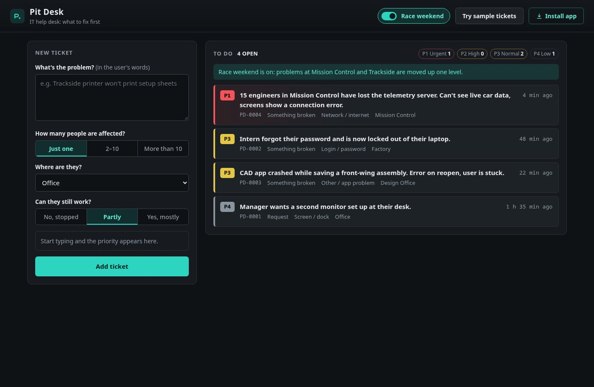
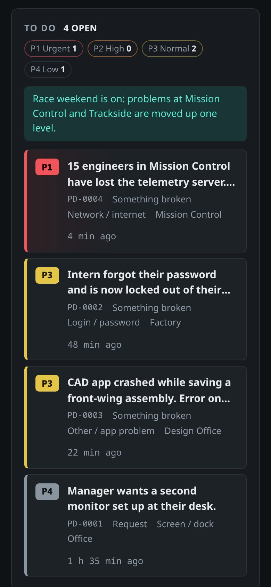
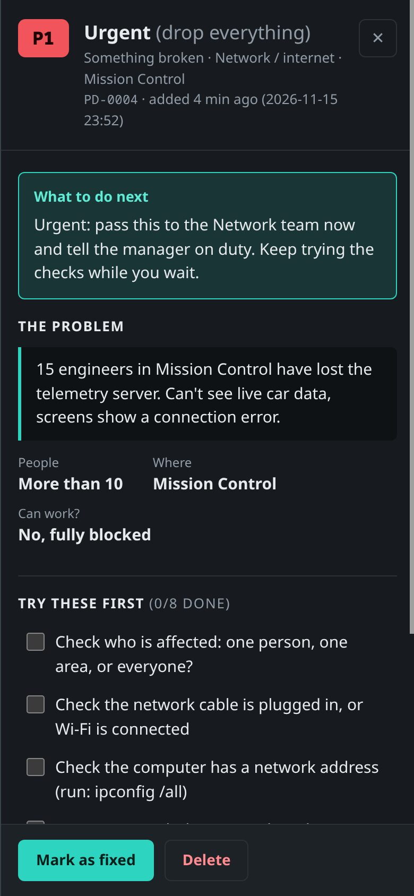

# Pit Desk

**When lots of people have computer problems at once, Pit Desk helps you decide which one to fix first, and tells you what to try.**

Picture the IT help desk at a motor-racing team on race weekend. The phone keeps ringing: a broken printer, a forgotten password, and then 15 engineers who can't see live data from the car. Pit Desk puts these in order, so the problem that matters most is always at the top.

👉 **Try it in your browser:** https://bapirlo07.github.io/pit-desk/ (nothing to install)
💻 **Download the app (Windows / Mac / Linux):** https://github.com/Bapirlo07/pit-desk/releases/latest

## How to use it

1. **Type the problem** the way the person described it, e.g. *"Trackside printer won't print"*.
2. **Answer three quick questions:** how many people are affected, where they are, and whether they can still work.
3. Pit Desk gives it a **priority**:

   | Label | Meaning |
   | --- | --- |
   | 🔴 **P1 Urgent** | Drop everything |
   | 🟠 **P2 High** | Next up |
   | 🟡 **P3 Normal** | When you're free |
   | ⚪ **P4 Low** | Can wait |

4. **Click a ticket.** The green **What to do next** box tells you the next step, and below it is a checklist of things to try. Tick each one as you go.
5. **Fixed?** Press **Mark as fixed**. **Still broken?** Press **Copy handover note** and send it to the expert team. It already explains the problem and what you've tried.

**Race weekend switch:** turn it on during a race. Problems at **Mission Control** and **Trackside** (the people running the car) then move up one level.

**Just looking?** Press **Try sample tickets** to fill it with example problems.

Your tickets are saved on your own device. Nothing is sent anywhere.




**On a phone:**

<p>
  
  &nbsp;
  
</p>

## Why I built it

*(The rest of this page is the technical detail.)*

I built this to practise the core skill of a first-line service desk: **triage by impact and urgency**. Speed matters on a race weekend. A ticket from Mission Control while the car is on track can't wait behind a request for a second monitor. Each call has to be explainable, though: *why* is this a P1 and that a P4? Pit Desk makes the reasoning visible. It shows the ITIL matrix with the chosen cell highlighted, lists the reasons in plain English, and keeps the escalation note to facts (it never states a guessed cause).

## Features

- **New ticket form**: description, users affected (1 / 2–10 / 10+), location, whether work is blocked. A live triage preview updates as you type.
- **Classification by keyword rules** (`src/triage/rules.ts`). No AI, so it's predictable and explainable. The ticket shows the keywords that matched.
- **Impact × urgency priority matrix**, with the selected cell highlighted.
- **Race weekend toggle**: Mission Control and Trackside tickets go up one level (never above P1). The queue re-prioritises the moment you flip it.
- **Possible problem detection**: 3+ open incidents in the same category are flagged *"Several people have this problem"*, the cue to look for a bigger underlying cause.
- **Knowledge base of first-line checks** for 8 categories plus a general fallback. Ticked checks are saved as "steps tried".
- **Escalation note** (shown as *Copy handover note*) with one-click copy, and an optional preview. It stays in standard IT format because it gets pasted into ticketing systems.
- **Live queue** sorted by priority, then age, colour-coded P1 red → P4 grey. Resolve (requires a one-line note), reopen, or delete.
- **Try sample tickets** loads four realistic race-weekend tickets.
- **Written for non-technical people**: everyday words on screen (*P1 Urgent*, *Something broken* / *Request*, *Mark as fixed*), plain-English checklists with any technical command in brackets, a *What to do next* box on every ticket, and the priority maths folded under *Why is this P1?*. The screen labels live in `src/labels.ts`.
- **Installable app (PWA)**: install it to the desktop or phone home screen. It opens in its own window and works **offline** after the first visit.
- Saved in `localStorage` (and still works if storage is blocked). Keyboard accessible. Works on a laptop and a phone.

## Desktop app

Download the installer for your system from **[Releases](https://github.com/Bapirlo07/pit-desk/releases/latest)**:

| System | File |
| --- | --- |
| Windows | `…_x64-setup.exe` (or `.msi`) |
| macOS (Intel + Apple Silicon) | `…_universal.dmg` |
| Linux | `.AppImage` (any distro), `.deb` or `.rpm` |

The installers aren't code-signed (that needs paid certificates), so the first launch shows a warning:
- **Windows:** *Windows protected your PC* → **More info** → **Run anyway**.
- **macOS:** right-click the app → **Open** → **Open**.

The desktop app is built with [Tauri](https://tauri.app). It's the same React code as the website, shown in the operating system's own web view, so the installer is only a few MB. It has no file, shell or network permissions.

## Install it from the browser instead

Open the live demo, then:
- **Chrome / Edge (Windows, macOS, Linux, ChromeOS):** click **Install app** in the header, or the install icon in the address bar.
- **Android (Chrome):** use **Install app**, or ⋮ → *Add to Home screen*.
- **iPhone / iPad (Safari):** tap Share → *Add to Home Screen*.

After the first load, the service worker (`public/sw.js`) caches the app, so it opens without a connection.

## How the priority matrix works

Priority = **Impact × Urgency**, the standard ITIL approach.

**Impact**: how many people are affected, and where.

| Users affected | Impact |
| --- | --- |
| 1 | Low |
| 2–10 | Medium |
| 10+ | High |

Mission Control and Trackside are **race-critical**, so impact goes **up one level** there (Low → Medium, Medium → High).

**Urgency**: how badly work is blocked right now.

| Work blocked? | Urgency |
| --- | --- |
| Yes, fully | High |
| Partly | Medium |
| No | Low |

**Matrix**

| Impact ↓ / Urgency → | High | Medium | Low |
| --- | --- | --- | --- |
| **High** | P1 | P2 | P3 |
| **Medium** | P2 | P3 | P4 |
| **Low** | P3 | P4 | P4 |

**Race weekend uplift**: when the toggle is ON, any Mission Control or Trackside ticket goes up one more priority level, capped at P1.

*Example:* a Trackside printer is down for 1 user and work is partly blocked.
- Impact: Low, raised to Medium because Trackside is race-critical.
- Urgency: Medium.
- Matrix: **P3**.
- Race weekend ON: **P2**.

## Project structure

For a file-by-file explanation, see **[docs/FILE-GUIDE.md](docs/FILE-GUIDE.md)**.

```
src/
├─ triage/               # pure logic, no React. Easy to test and explain
│  ├─ rules.ts           # incident / request keywords, problem threshold
│  ├─ knowledgeBase.ts   # categories, keywords, first-line checks, escalation teams
│  ├─ priority.ts        # impact, urgency, matrix, race-weekend uplift
│  ├─ problems.ts        # possible-problem detection
│  ├─ escalation.ts      # escalation note builder
│  ├─ index.ts           # triage() and triageQueue(): sorting and flags
│  └─ __tests__/         # Vitest unit tests
├─ components/           # React UI
├─ storage.ts            # localStorage, wrapped in try/catch
├─ demo.ts               # race-weekend demo tickets
└─ pwa.ts                # service worker registration + install prompt
public/
├─ manifest.webmanifest  # makes it installable
└─ sw.js                 # offline caching
src-tauri/               # desktop app shell (Tauri): window, icons, installer settings
```

Priority is **derived, not stored**. Every render re-triages the queue from the raw ticket facts, so toggling race weekend or editing rules updates everything consistently.

## Run it locally

Requires Node 20.19+ (CI uses Node 24).

```bash
npm install
npm run dev        # http://localhost:5173/pit-desk/
npm test           # unit tests (58)
npm run build      # production build in dist/
npm run preview    # serve the production build (the service worker only runs here, not in dev)
```

### Desktop app development

Needs [Rust](https://rustup.rs) plus the [Tauri prerequisites](https://tauri.app/start/prerequisites/) for your OS.

```bash
npm run app:dev     # opens the desktop window with live reload
npm run app:build   # builds installers into src-tauri/target/release/bundle/
```

## Deploy

**Desktop installers:** bump `version` in `package.json`, then push a matching tag:

```bash
git tag v1.0.1 && git push origin v1.0.1
```

`.github/workflows/release.yml` builds on Windows, macOS and Linux and publishes a GitHub Release with the installers. It takes about 10–15 minutes.

**Website:** pushing to `main` runs `.github/workflows/deploy.yml`, which tests, builds and publishes to GitHub Pages. In the repo, go to **Settings → Pages → Source** and choose **GitHub Actions** (one-time setup). The Vite `base` is `/pit-desk/`, so the repo must be named `pit-desk`.

## What I'd add next

- **ServiceNow integration**: create the incident or request directly from the escalation note via the ServiceNow Table API, and sync status back.
- **Real monitoring feeds**: auto-raise incidents from network or telemetry monitoring alerts, and link user tickets to an active alert.
- **SLA timers**: response and resolution targets per priority, with a countdown and a breach warning in the queue.
- Shared queue for the whole desk (backend + auth), with assignment to analysts.
- Major incident mode for P1s: comms templates and a stakeholder update timer.
- Editable knowledge base so the team can improve checks without a code change.
