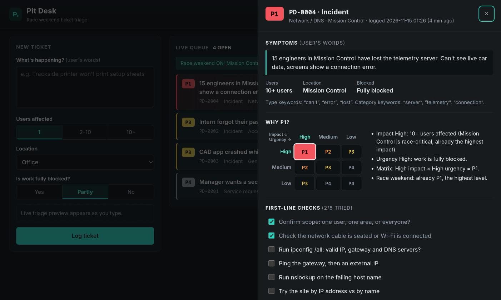

# Pit Desk

**Race-weekend IT service desk triage.** Log a ticket in the user's own words and Pit Desk tells you:
- whether it's an **incident** or a **service request**
- which **category** it falls under
- its **priority (P1–P4)**, and why
- the **first-line checks** to work through

It then writes a factual **escalation note** you can paste into a ticketing system.

**Live demo:** https://bapirlo07.github.io/pit-desk/. It's also an **installable app that works offline**, and has a built-in **guided tutorial**.




## Why I built it

I built this to practise the core skill of a first-line service desk: **triage by impact and urgency**. Speed matters on a race weekend. A ticket from Mission Control while the car is on track can't wait behind a request for a second monitor. Each call has to be explainable, though: *why* is this a P1 and that a P4? Pit Desk makes the reasoning visible. It shows the ITIL matrix with the chosen cell highlighted, lists the reasons in plain English, and keeps the escalation note to facts (it never states a guessed cause).

## Features

- **New ticket form**: description, users affected (1 / 2–10 / 10+), location, whether work is blocked. A live triage preview updates as you type.
- **Classification by keyword rules** (`src/triage/rules.ts`). No AI, so it's predictable and explainable. The ticket shows the keywords that matched.
- **Impact × urgency priority matrix**, with the selected cell highlighted.
- **Race weekend toggle**: Mission Control and Trackside tickets go up one level (never above P1). The queue re-prioritises the moment you flip it.
- **Possible problem detection**: 3+ open incidents in the same category are flagged *"possible underlying problem, raise for root-cause investigation"*.
- **Knowledge base of first-line checks** for 8 categories plus a general fallback. Ticked checks are saved as "steps tried".
- **Escalation note generator** with one-click copy.
- **Live queue** sorted by priority, then age, colour-coded P1 red → P4 grey. Resolve (requires a one-line note), reopen, or delete.
- **Race-weekend demo** button loads four realistic tickets.
- **Guided tutorial**: an 11-step walkthrough that spotlights each part of the app. Starts on first visit; replay it from the **Tutorial** button.
- **Installable app (PWA)**: install it to the desktop or phone home screen. It opens in its own window and works **offline** after the first visit.
- Saved in `localStorage` (and still works if storage is blocked). Keyboard accessible. Works on a laptop and a phone.

## Install it as an app

Open the live demo, then:
- **Chrome / Edge (Windows, macOS, Linux, ChromeOS):** click **Install app** in the header, or the install icon in the address bar.
- **Android (Chrome):** use **Install app**, or ⋮ → *Add to Home screen*.
- **iPhone / iPad (Safari):** tap Share → *Add to Home Screen*.

After the first load, the service worker (`public/sw.js`) caches the app, so it opens without a connection.

## How the priority matrix works

Priority = **Impact × Urgency**, the standard ITIL approach.

**Impact**: how many people are affected, and where.

| Users affected | Impact |
| --- | --- |
| 1 | Low |
| 2–10 | Medium |
| 10+ | High |

Mission Control and Trackside are **race-critical**, so impact goes **up one level** there (Low → Medium, Medium → High).

**Urgency**: how badly work is blocked right now.

| Work blocked? | Urgency |
| --- | --- |
| Yes, fully | High |
| Partly | Medium |
| No | Low |

**Matrix**

| Impact ↓ / Urgency → | High | Medium | Low |
| --- | --- | --- | --- |
| **High** | P1 | P2 | P3 |
| **Medium** | P2 | P3 | P4 |
| **Low** | P3 | P4 | P4 |

**Race weekend uplift**: when the toggle is ON, any Mission Control or Trackside ticket goes up one more priority level, capped at P1.

*Example:* a Trackside printer is down for 1 user and work is partly blocked.
- Impact: Low, raised to Medium because Trackside is race-critical.
- Urgency: Medium.
- Matrix: **P3**.
- Race weekend ON: **P2**.

## Project structure

For a file-by-file explanation, see **[docs/FILE-GUIDE.md](docs/FILE-GUIDE.md)**.

```
src/
├─ triage/               # pure logic, no React. Easy to test and explain
│  ├─ rules.ts           # incident / request keywords, problem threshold
│  ├─ knowledgeBase.ts   # categories, keywords, first-line checks, escalation teams
│  ├─ priority.ts        # impact, urgency, matrix, race-weekend uplift
│  ├─ problems.ts        # possible-problem detection
│  ├─ escalation.ts      # escalation note builder
│  ├─ index.ts           # triage() and triageQueue(): sorting and flags
│  └─ __tests__/         # Vitest unit tests
├─ tutorial/             # guided tour: steps (data), card positioning (pure), component
├─ components/           # React UI
├─ storage.ts            # localStorage, wrapped in try/catch
├─ demo.ts               # race-weekend demo tickets
└─ pwa.ts                # service worker registration + install prompt
public/
├─ manifest.webmanifest  # makes it installable
└─ sw.js                 # offline caching
```

Priority is **derived, not stored**. Every render re-triages the queue from the raw ticket facts, so toggling race weekend or editing rules updates everything consistently.

## Run it locally

Requires Node 20.19+ (CI uses Node 24).

```bash
npm install
npm run dev        # http://localhost:5173/pit-desk/
npm test           # unit tests (58)
npm run build      # production build in dist/
npm run preview    # serve the production build (the service worker only runs here, not in dev)
```

## Deploy

Pushing to `main` runs `.github/workflows/deploy.yml`, which tests, builds and publishes to GitHub Pages. In the repo, go to **Settings → Pages → Source** and choose **GitHub Actions** (one-time setup). The Vite `base` is `/pit-desk/`, so the repo must be named `pit-desk`.

## What I'd add next

- **ServiceNow integration**: create the incident or request directly from the escalation note via the ServiceNow Table API, and sync status back.
- **Real monitoring feeds**: auto-raise incidents from network or telemetry monitoring alerts, and link user tickets to an active alert.
- **SLA timers**: response and resolution targets per priority, with a countdown and a breach warning in the queue.
- Shared queue for the whole desk (backend + auth), with assignment to analysts.
- Major incident mode for P1s: comms templates and a stakeholder update timer.
- Editable knowledge base so the team can improve checks without a code change.
